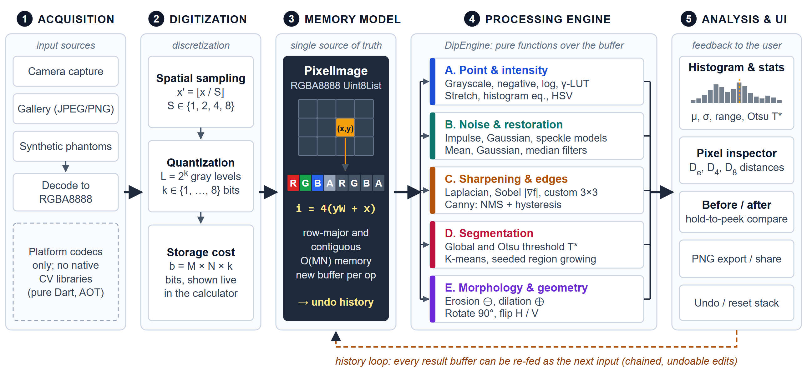
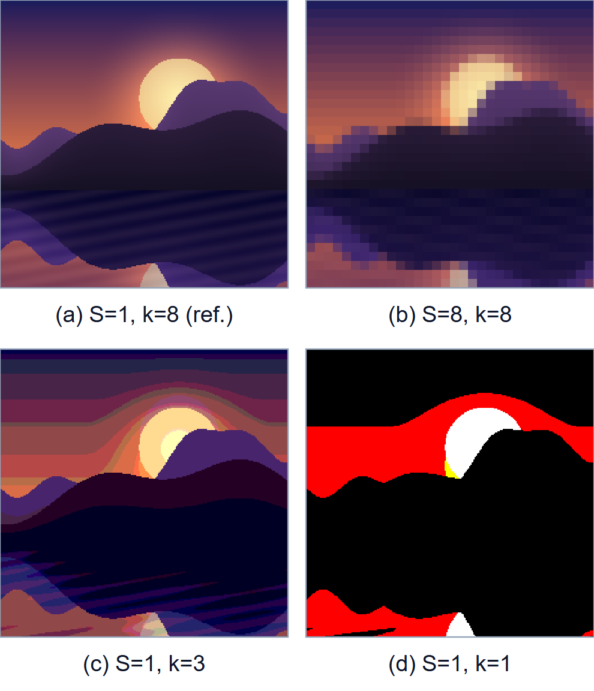

# DIP Studio: A Dependency-Free Cross-Platform Engine for Real-Time Digital Image Processing on Mobile and Edge Devices

*IEEE Transactions on Image Processing Format*

---

### Abstract
Classical digital image processing (DIP) operators remain essential wherever results must be deterministic, explainable, and computable on modest hardware. Bringing a complete operator suite to mobile devices, however, usually means bundling native C/C++ libraries through platform-specific bindings, which inflates application size and complicates maintenance. This paper presents DIP Studio, a cross-platform image processing engine and application written entirely in ahead-of-time (AOT) compiled Dart, with no native vision dependencies. Every operator acts directly on one contiguous RGBA8888 byte buffer, and the system is organized as a five-stage pipeline: acquisition, digitization, memory model, processing engine, and analysis. The engine covers spatial sampling and $k$-bit quantization, intensity transformations, histogram equalization, linear and order-statistic filtering, Laplacian and Sobel differentiation, Canny edge detection, Otsu thresholding, $K$-means clustering, seeded region growing, and grayscale morphology. We formalize each operator, state its complexity, and benchmark the implementation at $256^2$, $512^2$, and $1024^2$ pixels. Point operations reach 280.8 MP/s and histogram computation 127.4 MP/s at one megapixel. On a synthetic phantom corrupted by 10% impulse noise, a $3\times3$ median filter raises PSNR from 14.40 dB to 31.45 dB (+17.05 dB), 9.64 dB above an equally sized mean filter. The complete Android release build occupies 19.9 MB. These results show that a dependency-free, memory-safe implementation is a practical basis for interactive DIP education and lightweight edge vision.

**Index Terms**—Digital image processing, spatial filtering, histogram equalization, Otsu thresholding, Canny edge detection, K-means clustering, mathematical morphology, image restoration, mobile computing, edge vision.

---

## I. Introduction

Digital image processing (DIP) studies the transformation, enhancement, and analysis of two-dimensional signals that have been discretized in both space and amplitude [1]. Although learned models now dominate high-level recognition, classical operators such as intensity mappings, spatial filters, thresholding, and mathematical morphology remain the first stage of almost every vision pipeline, and they are the core of DIP teaching [1], [3], [12]. Their behaviour is deterministic and fully explainable, which matters in forensic, metrological, and medical settings where every pixel change must be justified [5], [6].

Deploying a complete operator suite on phones and tablets is nevertheless awkward. Mature libraries such as OpenCV [4] are written in C/C++ and reach mobile applications through foreign-function interfaces and per-ABI native binaries. This adds build complexity, enlarges the installed package, and moves memory safety outside the guarantees of the host language. Interactive teaching tools face a second problem: the user must see the image, the controls, and live statistics such as the histogram on a small screen at once.

This paper presents **DIP Studio**, an engine and application that implements the standard DIP curriculum in pure, AOT-compiled Dart on top of the Flutter toolkit, with no native vision library. All operators read and write one contiguous RGBA8888 buffer, so a result can be displayed, measured, exported, or fed into the next operator without conversion. The contributions are as follows.

- **Architecture.** A five-stage pipeline (acquisition, digitization, memory model, processing engine, analysis) built around a single linear pixel buffer and pure operator functions (Section III, Fig. 1).
- **Formulation.** A unified mathematical description of 20+ operators in five families, with their asymptotic cost (Section IV, Table I).
- **Evaluation.** Latency and throughput at three resolutions, together with MSE/PSNR restoration and contrast measurements computed by the same engine (Section V).
- **Deployment.** A 19.9 MB Android release build with a canvas-first interface that hides tool panels until they are needed (Section III-D).

Section II reviews related work. Section III describes the architecture, Section IV the operators, and Section V the experiments. Section VI discusses limitations, and Section VII concludes.

## II. Related Work

### A. Image Processing Libraries

OpenCV [4] is the de facto standard for native computer vision and provides highly optimized, often SIMD-accelerated, kernels. On Android it is used through Java or JNI wrappers around per-architecture shared libraries. Python ecosystems such as scikit-image [19] favour readable, NumPy-based implementations and are widely used for teaching and research, but they are not designed for on-device mobile deployment. ImageJ [20] offers an extensible desktop workbench for scientific imaging. DIP Studio targets the gap between these tools: a self-contained mobile application whose operators are as readable as a textbook yet compiled to native code.

### B. Classical Operators

The engine implements well-established methods: histogram equalization and its adaptive variants [10], order-statistic median filtering [7], Laplacian and gradient-based edge detection [18], the Canny detector [8], Otsu thresholding [5], $K$-means clustering [9], seeded region growing [14], and mathematical morphology [6], [13]. Our aim is not new operators; it is a transparent, dependency-free implementation that reproduces the textbook formulation exactly and is fast enough for interactive use.

## III. System Architecture

Fig. 1 summarizes the pipeline. Data flows left to right through five stages, and the history loop at the bottom lets any result become the next input.

**Fig. 1.** Architecture of DIP Studio. Images from three sources are decoded once, optionally re-digitized, and stored in a single RGBA8888 buffer. Five operator families (A–E) map buffers to new buffers, and the analysis layer reports histogram statistics, pixel-level measurements, and before/after comparisons. Each result is pushed onto an undo stack and can be chained into the next operation.

### A. Acquisition and Digitization

Images enter from the camera, the gallery (JPEG/PNG), or one of four analytic phantoms generated on the device (a sunset scene, a low-contrast ring phantom, a coin/cell scene, and a test card). The phantoms give reproducible inputs for teaching and benchmarking. Platform codecs decode every source into RGBA8888. The digitization stage then simulates spatial sampling with factor $S$ and intensity quantization with $k$ bits (Section IV-A) and reports the storage cost live.

### B. Memory Model

An image is a `PixelImage`: width $W$, height $H$, and a `Uint8List` of $4WH$ bytes in row-major order. Channel $c\in\{0,1,2,3\}$ of pixel $(x, y)$ is stored at

$$
i(x, y, c) = 4\,(yW + x) + c, \tag{1}
$$

so neighbourhood access is plain integer arithmetic and a raster scan touches memory sequentially, which suits hardware prefetchers. Operators never mutate their input; each returns a new buffer. This makes undo trivial, keeps the operators free of side effects, and lets the UI compare any two states.

### C. Processing Engine

The engine is a set of static, pure functions grouped into five families (Table I). Point operators that depend only on the input intensity are compiled into 256-entry look-up tables (LUTs), so their per-pixel cost is a single indexed load. Neighbourhood operators use replicated borders. Colour images are processed per channel, except where a luminance or HSV formulation is required to avoid hue shifts.

**TABLE I:** Operator families implemented in DIP Studio and their asymptotic cost ($M\times N$ image, $k\times k$ window, $L=256$ levels)

| Fam. | Operator | Parameters | Cost |
| :--- | :--- | :--- | :--- |
| A | Grayscale, negative, log | — | $O(MN)$ |
| A | Power-law (gamma) | $\gamma$, 256-entry LUT | $O(MN+L)$ |
| A | Contrast stretch | $r_{\min}, r_{\max}$ | $O(MN)$ |
| A | Histogram equalization | RGB or HSV value | $O(MN+L)$ |
| B | Mean / Gaussian filter | $k\times k$, $\sigma$ | $O(MNk^2)$ |
| B | Median filter | $k\times k$ | $O(MNk^2\log k)$ |
| C | Laplacian, Sobel, custom | $3\times3$ kernel | $O(MN)$ |
| C | Canny edge detector | $T_{\mathrm{low}}, T_{\mathrm{high}}$ | $O(MN)$ |
| D | Otsu threshold | automatic $T^{*}$ | $O(MN+L^2)$ |
| D | $K$-means clustering | $K$, iterations $I$ | $O(MNKI)$ |
| D | Seeded region growing | seed, tolerance | $O(MN)$ |
| E | Erosion / dilation | $3\times3$ or $5\times5$ | $O(MNk^2)$ |
| E | Rotate $90^{\circ}$, flip | — | $O(MN)$ |

### D. Analysis and Interaction Layer

After every operation the engine recomputes red, green, blue, and luminance histograms together with the mean $\mu$, standard deviation $\sigma$, intensity range, and Otsu threshold $T^{*}$. A pixel inspector reports RGB and gray values and the Euclidean, city-block, and chessboard distances between two probed points. The user can hold the canvas to peek at the original image, export the result as PNG, and undo or reset the history.

The interface is canvas-first. Tools are grouped into five tabs (*Enhance*, *Filters & Noise*, *Segment*, *Digitize*, *Inspect*) inside a drawer that stays collapsed by default, and the histogram can shrink to a single row of statistics. The image therefore keeps most of the screen, and the controls appear only when requested.

## IV. Mathematical Formulation

### A. Digitization

A continuous scene $f(x, y)$ is sampled on an $M\times N$ grid and each sample is quantized to $L$ levels. With $k$ bits per sample,

$$
L = 2^{k}, \qquad b = M \times N \times k \tag{2}
$$

where $b$ is the storage in bits; a $1024\times1024$ 8-bit image needs $b = 8{,}388{,}608$ bits (1 MiB). DIP Studio simulates coarser sampling with factor $S$ and coarser quantization with $k' < 8$ bits:

$$
f_q(x, y) = \left\lfloor \frac{f(S\lfloor x/S \rfloor,\, S\lfloor y/S \rfloor)}{256/2^{k'}} \right\rfloor \cdot \frac{255}{2^{k'}-1} \tag{3}
$$

Fig. 2 shows both effects. Sampling with $S=8$ produces block artefacts (27.95 dB PSNR against the reference), whereas $k=3$ introduces false contours in smooth gradients (24.09 dB) and $k=1$ leaves a binary image per channel (11.83 dB).

**Fig. 2.** Spatial sampling and intensity quantization computed by the engine on the sunset phantom: (a) reference, (b) sampling factor $S=8$, (c) $k=3$ bits per channel, and (d) $k=1$ bit per channel.

### B. Point Operations

A point operation $s = T(r)$ maps an input level $r\in[0, L-1]$ to an output level $s$ independently of the neighbourhood. Luminance follows ITU-R BT.601 [11]:

$$
Y = 0.299R + 0.587G + 0.114B \tag{4}
$$

The negative, logarithmic, and power-law (gamma) transformations are

$$
s = (L-1) - r, \qquad s = c\,\ln(1+r), \qquad s = (L-1)\left(\frac{r}{L-1}\right)^{\gamma} \tag{5}
$$

where $c = (L-1)/\ln(1+r_{\max})$ maps the brightest input to $L-1$. Contrast stretching maps the occupied range $[r_{\min}, r_{\max}]$ linearly onto the full scale:

$$
s = \frac{r - r_{\min}}{r_{\max} - r_{\min}}\,(L-1) \tag{6}
$$

### C. Histogram Equalization

Let $n_k$ be the number of pixels with level $r_k$. The normalized histogram and the equalizing transformation are [1], [10]

$$
p_r(r_k) = \frac{n_k}{MN}, \qquad s_k = (L-1)\sum_{j=0}^{k} p_r(r_j) \tag{7}
$$

Equalizing $R$, $G$, and $B$ independently shifts hues, so colour images are equalized either on luminance, with all channels scaled by $T(Y)/Y$, or on the HSV value channel with hue and saturation unchanged.

### D. Spatial Filtering

A $(2a+1)\times(2b+1)$ kernel $w$ is applied by correlation; convolution is the same operation with the kernel rotated by $180^{\circ}$:

$$
g(x, y) = \sum_{s=-a}^{a}\sum_{t=-b}^{b} w(s, t)\, f(x+s,\, y+t) \tag{8}
$$

The engine provides box (mean) filters, sampled Gaussian kernels

$$
G(x, y) = \frac{1}{2\pi\sigma^{2}} \exp\!\left(-\frac{x^{2}+y^{2}}{2\sigma^{2}}\right) \tag{9}
$$

normalized to unit sum, and arbitrary user-defined $3\times3$ kernels. The median filter replaces each pixel with the median of its window $W$ [7]:

$$
g(x, y) = \operatorname{median}\{\, f(x+s,\, y+t) : (s, t) \in W \,\} \tag{10}
$$

Impulse noise sets isolated pixels to 0 or 255; these values fall at the ends of the sorted window and never become the median, so the filter removes them without averaging them into neighbouring edges.

### E. Sharpening and Edge Detection

The Laplacian $\nabla^2 f = \partial^2 f/\partial x^2 + \partial^2 f/\partial y^2$ is discretized with the 4- or 8-neighbour kernels

$$
w_4 = \begin{bmatrix} 0 & 1 & 0 \\ 1 & -4 & 1 \\ 0 & 1 & 0 \end{bmatrix}, \qquad w_8 = \begin{bmatrix} 1 & 1 & 1 \\ 1 & -8 & 1 \\ 1 & 1 & 1 \end{bmatrix} \tag{11}
$$

and the image is sharpened by $g = f - c\,\nabla^2 f$. Sobel derivatives $G_x$ and $G_y$ give the gradient magnitude and direction

$$
|\nabla f| = \sqrt{G_x^{2} + G_y^{2}}, \qquad \theta = \operatorname{atan2}(G_y, G_x) \tag{12}
$$

The Canny detector [8] chains Gaussian smoothing, Sobel gradients, non-maximum suppression along $\theta$ quantized to $0^{\circ}$, $45^{\circ}$, $90^{\circ}$, and $135^{\circ}$, double thresholding with $T_{\mathrm{low}}=35$ and $T_{\mathrm{high}}=85$, and 8-connected hysteresis.

### F. Segmentation

Otsu's method [5] chooses the threshold that maximizes the between-class variance of the luminance histogram:

$$
\sigma_B^{2}(T) = \omega_0(T)\,\omega_1(T)\,[\mu_0(T) - \mu_1(T)]^{2} \tag{13}
$$

and selects $T^{*} = \operatorname{arg\,max}_{T}\,\sigma_B^{2}(T)$, where $\omega_i$ and $\mu_i$ are the probability and mean of the two classes. Algorithm 1 lists the single-pass procedure used by the engine. $K$-means [9] clusters the RGB vectors $\mathbf{x}_i$ by minimizing the within-cluster sum of squares

$$
J = \sum_{j=1}^{K} \sum_{\mathbf{x}_i \in C_j} \lVert \mathbf{x}_i - \mathbf{m}_j \rVert^{2} \tag{14}
$$

with Lloyd iterations, and seeded region growing [14] adds 4- or 8-connected neighbours whose intensity lies within a tolerance of the seed.

> **Algorithm 1:** Otsu threshold selection from a 256-bin histogram
>
> 1. **Input:** luminance histogram $h[0..L-1]$, pixel count $N$
> 2. $p_i \leftarrow h[i]/N$;  $\mu_T \leftarrow \sum_i i\,p_i$
> 3. $\omega \leftarrow 0$;  $\mu \leftarrow 0$;  $\sigma^{*} \leftarrow 0$;  $T^{*} \leftarrow 0$
> 4. **for** $T = 0$ **to** $L-2$ **do**
> 5.  $\omega \leftarrow \omega + p_T$;  $\mu \leftarrow \mu + T\,p_T$
> 6.  **if** $\omega = 0$ **or** $\omega = 1$ **then continue**
> 7.  $\sigma_B^{2} \leftarrow (\mu_T\,\omega - \mu)^{2} / (\omega(1-\omega))$
> 8.  **if** $\sigma_B^{2} > \sigma^{*}$ **then** $\sigma^{*} \leftarrow \sigma_B^{2}$;  $T^{*} \leftarrow T$
> 9. **return** $T^{*}$

### G. Morphology and Distance Metrics

Grayscale erosion and dilation with a flat structuring element $B$ are [6], [13]

$$
(f \ominus B)(x, y) = \min_{(s,t)\in B} f(x+s,\, y+t) \tag{15}
$$

$$
(f \oplus B)(x, y) = \max_{(s,t)\in B} f(x-s,\, y-t) \tag{16}
$$

and opening, erosion followed by dilation, removes structures smaller than $B$. For two pixels $p=(x, y)$ and $q=(s, t)$ the inspector reports Euclidean, city-block, and chessboard distances:

$$
D_e = \sqrt{(x-s)^{2} + (y-t)^{2}} \tag{17}
$$

$$
D_4 = |x-s| + |y-t|, \;\; D_8 = \max(|x-s|, |y-t|) \tag{18}
$$

## V. Experimental Evaluation

### A. Setup

All measurements were produced by the engine itself through two scripts in the repository: `tool/benchmark_suite.dart` for timing and `tool/export_paper_figures.dart` for the figures and quality metrics. Timing runs used the Dart VM on a laptop with an AMD Ryzen 5 7520U (x86-64, up to 2.8 GHz base clock), single-threaded. Each value is the mean of five consecutive runs after a warm-up call, on the synthetic sunset scene at $256^2$, $512^2$, and $1024^2$ pixels. Times exclude decoding and display. Canny, $K$-means, and morphology were benchmarked only up to $512^2$.

### B. Latency and Throughput

Table II lists latency and throughput, and Fig. 3 compares all operators at $512^2$. Point operators and geometric transforms run at roughly 60 to 280 MP/s, so even a 1-MP image is processed in 4 to 13 ms. LUT-based gamma correction is the fastest operator at the two smaller sizes, and throughput generally rises with resolution as fixed per-call overhead is amortized. Neighbourhood operators are one to two orders of magnitude slower, as their $O(MNk^2)$ cost predicts. The median filter is the slowest (1.7 MP/s) because it sorts nine values per pixel and channel; a $512^2$ image still takes 153 ms, fast enough for interactive use.

**TABLE II:** Execution latency (ms) and throughput (MP/s) of the DIP Studio engine; mean of five runs, single thread

| Group | Operator | t256 | r256 | t512 | r512 | t1024 | r1024 |
| :--- | :--- | ---: | ---: | ---: | ---: | ---: | ---: |
| Point | Grayscale (BT.601) | 0.68 | 96.07 | 2.08 | 125.81 | 7.56 | 138.69 |
| Point | Negative | 0.77 | 85.13 | 1.51 | 173.63 | 4.84 | 216.73 |
| Point | Log transform | 0.93 | 70.77 | 1.80 | 145.91 | 3.73 | **280.83** |
| Point | Gamma LUT ($\gamma=0.65$) | 0.28 | 236.42 | 1.04 | 251.43 | 4.50 | 232.80 |
| Point | Contrast stretch | 2.12 | 30.97 | 4.37 | 59.94 | 12.75 | 82.21 |
| Statistics | 256-bin histogram | 0.34 | 192.08 | 2.10 | 124.75 | 8.23 | 127.41 |
| Statistics | Histogram equalization | 5.47 | 11.98 | 18.63 | 14.07 | 70.82 | 14.81 |
| Statistics | Otsu threshold | 1.25 | 52.50 | 4.15 | 63.12 | 13.09 | 80.09 |
| Filtering | Mean $3\times3$ | 6.35 | 10.32 | 20.32 | 12.90 | 86.48 | 12.12 |
| Filtering | Gaussian $3\times3$, $\sigma=1.2$ | 11.26 | 5.82 | 39.79 | 6.59 | 151.72 | 6.91 |
| Filtering | Median $3\times3$ | 47.82 | 1.37 | 153.10 | 1.71 | 588.55 | 1.78 |
| Filtering | Laplacian sharpen (8-N) | 14.00 | 4.68 | 39.47 | 6.64 | 154.92 | 6.77 |
| Filtering | Sobel gradient | 11.35 | 5.77 | 34.09 | 7.69 | 108.10 | 9.70 |
| Segmentation | Canny edge detector | 19.99 | 3.28 | 64.14 | 4.09 | — | — |
| Segmentation | $K$-means ($K=4$, $I=5$) | 14.23 | 4.61 | 49.23 | 5.32 | — | — |
| Segmentation | Erosion $3\times3$ | 7.15 | 9.17 | 26.29 | 9.97 | — | — |
| Segmentation | Dilation $3\times3$ | 6.23 | 10.52 | 24.88 | 10.54 | — | — |
| Geometry | Rotate $90^{\circ}$ clockwise | 1.24 | 52.67 | 2.20 | 118.97 | 12.10 | 86.63 |
| Geometry | Horizontal flip | 1.00 | 65.24 | 2.18 | 120.48 | 5.29 | 198.13 |

**Fig. 3.** Throughput of each operator at $512\times512$ on a logarithmic axis, coloured by operator family as in Fig. 1. Point and geometric operators exceed 100 MP/s in most cases; windowed operators fall to 2–13 MP/s.

### C. Noise Restoration

Restoration quality is measured against the clean image with

$$
\mathrm{MSE} = \frac{1}{3MN}\sum_{x,y,c} \big[f(x,y,c) - \hat{f}(x,y,c)\big]^{2} \tag{19}
$$

$$
\mathrm{PSNR} = 10\log_{10}\!\left(\frac{255^{2}}{\mathrm{MSE}}\right)\;\mathrm{dB} \tag{20}
$$

on the $256\times256$ coin/cell phantom. Table III and Fig. 4 show the results. For 10% impulse noise the $3\times3$ median filter lowers the MSE from 2363.62 to 46.57, a PSNR gain of 17.05 dB, and it beats the mean filter of the same size by 9.64 dB. The mean filter spreads each impulse over its neighbours and blurs the object boundaries. For additive Gaussian noise with $\sigma=20$ the ranking reverses: linear smoothing suits this noise model, and the Gaussian kernel ($\sigma=1.2$) gives the best result, 27.24 dB.

**TABLE III:** Objective restoration quality on the $256\times256$ coin/cell phantom

| Noise | Output | MSE | PSNR (dB) | $\Delta$ (dB) |
| :--- | :--- | ---: | ---: | ---: |
| Impulse 10% | Noisy input | 2363.62 | 14.40 | — |
| Impulse 10% | Mean $3\times3$ | 429.00 | 21.81 | +7.41 |
| Impulse 10% | **Median $3\times3$** | **46.57** | **31.45** | **+17.05** |
| Gaussian $\sigma=20$ | Noisy input | 361.64 | 22.55 | — |
| Gaussian $\sigma=20$ | Mean $3\times3$ | 134.55 | 26.84 | +4.29 |
| Gaussian $\sigma=20$ | **Gaussian $3\times3$** | **122.85** | **27.24** | **+4.69** |

**Fig. 4.** Restoration on the coin/cell phantom (PSNR against the ground truth): (a) ground truth, (b) 10% impulse noise, (c) mean filter, (d) median filter, (e) Gaussian noise with $\sigma=20$, (f) Gaussian filter with $\sigma=1.2$ applied to (e).

### D. Contrast Enhancement and Segmentation

Table IV reports the effect of equalization on the low-contrast ring phantom, whose luminance occupies only [96, 148]. Equalization stretches it across the full [0, 255] range and raises the standard deviation from 16.82 to 88.67, an increase of 427%. The number of occupied gray levels falls slightly, from 20 to 18: the discrete CDF mapping can merge levels but never creates new ones, so contrast comes from spacing the existing levels further apart.

**TABLE IV:** Luminance statistics of the low-contrast phantom before and after histogram equalization

| Image | Range | Spread | Levels | Mean | Std |
| :--- | ---: | ---: | ---: | ---: | ---: |
| Input | [96, 148] | 52 | 20 | 108.98 | 16.82 |
| Equalized | [0, 255] | **255** | 18 | 70.26 | **88.67** |

Fig. 5 illustrates the remaining families. Otsu's method selects $T^{*}=104$ on the coin/cell phantom and separates all five objects. Canny produces thin, closed contours covering 1.33% of the pixels. A $5\times5$ opening removes the thin ring fragment left by thresholding, and $K$-means with $K=4$ reduces the sunset scene to four colour regions.

**Fig. 5.** Enhancement and segmentation computed by the engine: (a) low-contrast phantom, (b) after histogram equalization, (c) Otsu thresholding of the coin/cell phantom, (d) Canny edges, (e) $5\times5$ morphological opening of (c), (f) $K$-means clustering ($K=4$) of the sunset scene.

## VI. Discussion

*Footprint and portability.* Because every operator is ordinary Dart code, the same source runs on Android, iOS, desktop, and the web, and the Android release APK is 19.9 MB, most of it the Flutter runtime. No per-ABI native libraries or JNI bindings must be built, shipped, or kept in step with OS updates, and out-of-bounds access is caught by the language runtime instead of corrupting memory.

*Transparency.* Each operator is a short function that mirrors its equation in Section IV, and the UI shows the histogram, statistics, and storage cost immediately after every step. This makes the application useful as a teaching companion: students can relate a formula, its parameters, and its visual and statistical effect directly.

*Limitations.* The engine is single-threaded and does not use SIMD or the GPU, so it will not match optimized native libraries on large images; the median filter in particular would benefit from histogram-based or separable algorithms [7]. The quality experiments use synthetic phantoms, which give exact ground truth but are simpler than natural photographs. Timing was measured on a laptop CPU with the Dart VM, so absolute numbers on phones will differ, although the relative cost of the operator families should hold.

## VII. Conclusion

We presented DIP Studio, a dependency-free engine and mobile application that implements the classical DIP operator set on a single linear RGBA buffer. The five-stage architecture keeps acquisition, digitization, processing, and analysis cleanly separated while allowing results to be chained and undone. Point operations reach 280.8 MP/s, the median filter restores impulse-noise images by 17.05 dB, and the full application fits in a 19.9 MB release build. Future work includes multi-threaded and SIMD kernels, frequency-domain filtering with the 2-D FFT, wavelet multiresolution analysis, perceptual metrics such as SSIM [15], and evaluation on natural-image benchmarks and mobile hardware.

## References

[1] R. C. Gonzalez and R. E. Woods, *Digital Image Processing*, 4th ed. New York, NY, USA: Pearson, 2018.

[2] R. Szeliski, *Computer Vision: Algorithms and Applications*, 2nd ed. Cham, Switzerland: Springer, 2022.

[3] W. K. Pratt, *Digital Image Processing: PIKS Scientific Inside*, 4th ed. Hoboken, NJ, USA: Wiley, 2007.

[4] G. Bradski and A. Kaehler, *Learning OpenCV: Computer Vision with the OpenCV Library*. Sebastopol, CA, USA: O'Reilly Media, 2008.

[5] N. Otsu, “A threshold selection method from gray-level histograms,” *IEEE Trans. Syst., Man, Cybern.*, vol. SMC-9, no. 1, pp. 62–66, Jan. 1979.

[6] J. Serra, *Image Analysis and Mathematical Morphology*. London, U.K.: Academic Press, 1982.

[7] T. S. Huang, G. J. Yang, and G. Y. Tang, “A fast two-dimensional median filtering algorithm,” *IEEE Trans. Acoust., Speech, Signal Process.*, vol. ASSP-27, no. 1, pp. 13–18, Feb. 1979.

[8] J. Canny, “A computational approach to edge detection,” *IEEE Trans. Pattern Anal. Mach. Intell.*, vol. PAMI-8, no. 6, pp. 679–698, Nov. 1986.

[9] J. MacQueen, “Some methods for classification and analysis of multivariate observations,” in *Proc. 5th Berkeley Symp. Math. Statist. Probab.*, vol. 1, 1967, pp. 281–297.

[10] S. M. Pizer *et al.*, “Adaptive histogram equalization and its variations,” *Comput. Vis., Graph., Image Process.*, vol. 39, no. 3, pp. 355–368, Sep. 1987.

[11] *Studio Encoding Parameters of Digital Television for Standard 4:3 and Wide-Screen 16:9 Aspect Ratios*, ITU-R Recommendation BT.601-7, Mar. 2011.

[12] A. K. Jain, *Fundamentals of Digital Image Processing*. Englewood Cliffs, NJ, USA: Prentice-Hall, 1989.

[13] P. Soille, *Morphological Image Analysis: Principles and Applications*, 2nd ed. Berlin, Germany: Springer, 2003.

[14] R. Adams and L. Bischof, “Seeded region growing,” *IEEE Trans. Pattern Anal. Mach. Intell.*, vol. 16, no. 6, pp. 641–647, Jun. 1994.

[15] Z. Wang, A. C. Bovik, H. R. Sheikh, and E. P. Simoncelli, “Image quality assessment: From error visibility to structural similarity,” *IEEE Trans. Image Process.*, vol. 13, no. 4, pp. 600–612, Apr. 2004.

[16] E. H. Land and J. J. McCann, “Lightness and retinex theory,” *J. Opt. Soc. Amer.*, vol. 61, no. 1, pp. 1–11, Jan. 1971.

[17] A. Rosenfeld and J. L. Pfaltz, “Sequential operations in digital picture processing,” *J. ACM*, vol. 13, no. 4, pp. 471–494, Oct. 1966.

[18] D. Marr and E. Hildreth, “Theory of edge detection,” *Proc. Roy. Soc. London B*, vol. 207, no. 1167, pp. 187–217, Feb. 1980.

[19] S. van der Walt *et al.*, “scikit-image: Image processing in Python,” *PeerJ*, vol. 2, Art. no. e453, Jun. 2014.

[20] C. A. Schneider, W. S. Rasband, and K. W. Eliceiri, “NIH Image to ImageJ: 25 years of image analysis,” *Nature Methods*, vol. 9, no. 7, pp. 671–675, Jul. 2012.
